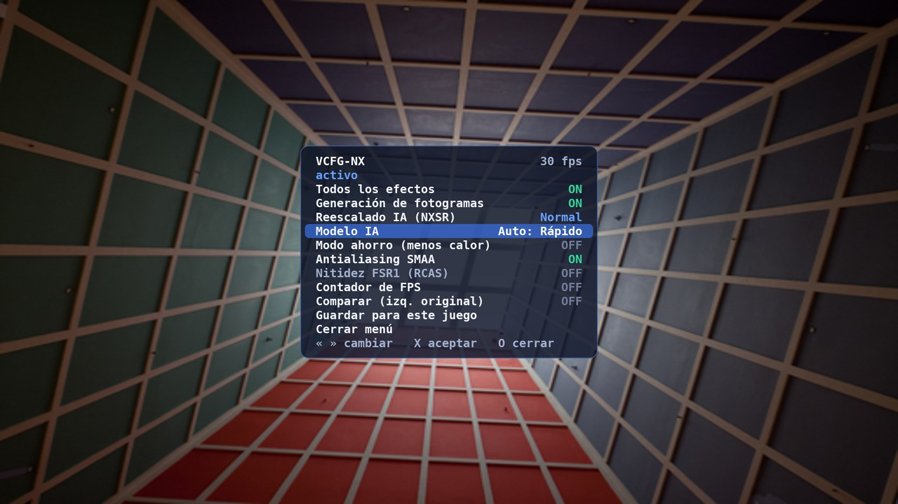
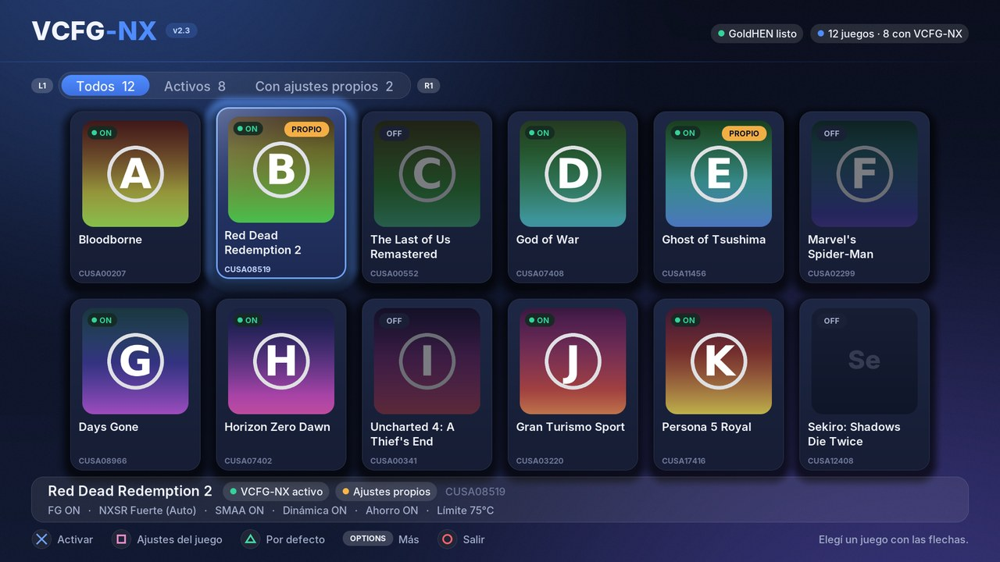
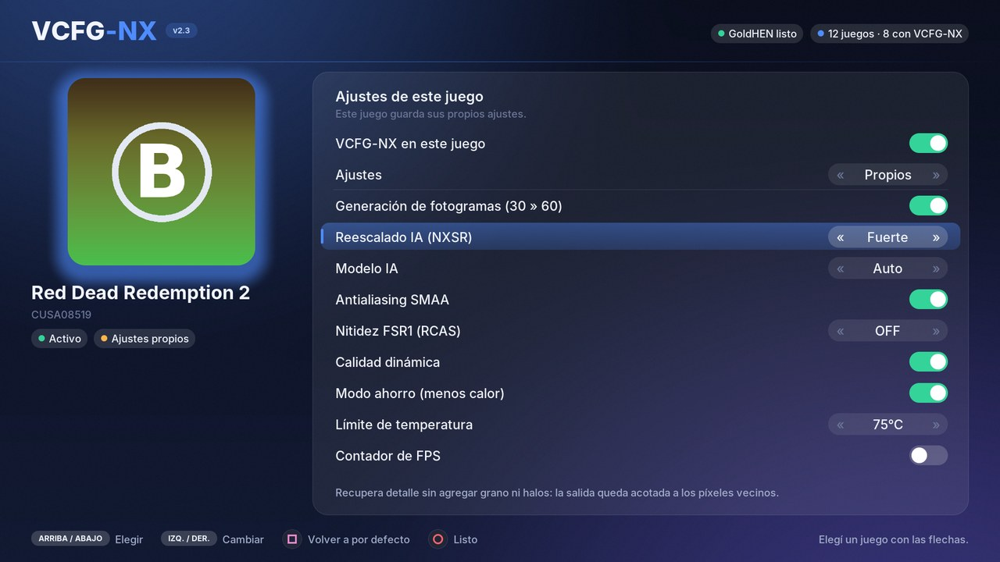

# VCFG-NX 2.61: frame generation + reescalado IA (NXSR) para PS4 (GoldHEN)

Rediseño del **VCFG v2.14** (generador de fotogramas en beta de la comunidad
de GoldHEN) que además incorpora un **modelo de reescalado/realce propio,
NXSR**, como alternativa a GNMScale pero sin el granulado que este agrega.
Todo con la interfaz de VCFG: app instaladora con lista de juegos y menú en
pantalla con **L3+R3**.

**Descarga:** [`dist/VCFG-NX_v2.54.pkg`](dist/VCFG-NX_v2.54.pkg) (fPKG, app) ·
[`dist/vcfg_nx.prx`](dist/vcfg_nx.prx) (plugin suelto) · [`dist/SHA256SUMS.txt`](dist/SHA256SUMS.txt)

| servicio | qué hace |
|---|---|
| **Generación de fotogramas** (NXFlow) | 30 → 60 fps: block-matching + red que corrige vectores y oclusiones. Sin cambios respecto de la 1.0 |
| **Reescalado IA (NXSR)** | red de 16 canales que reconstruye detalle (TAA borroso, render a menos resolución) y **nunca agrega grano ni halos**: su salida queda acotada al rango de los píxeles vecinos |
| SMAA 1x | antialiasing de bordes |
| FSR1 | EASU si el juego renderiza por debajo de la salida; RCAS como nitidez clásica (solo sin NXSR) |

> **Estado — leer antes de instalar.** Compila con el toolchain real
> (OpenOrbis + GoldHEN SDK), el PKG se genera y se verifica en PC, y toda la
> lógica del plugin se probó en un **simulador de consola** con detectores de
> errores de memoria. Pero **nada se ejecutó todavía en una PS4**: es una beta.
> Las protecciones de abajo existen para que, si algo falla, el juego siga
> como si el plugin no estuviera. Detalles en [`docs/resultados.md`](docs/resultados.md)
> y [`docs/DISENO_NX.md`](docs/DISENO_NX.md).

## NXSR frente a GNMScale

GNMScale ([análisis](docs/ANALISIS_GNMSCALE.md)) trae tres redes de 4 canales
que son filtros de nitidez aprendidos sin límite. Evaluadas sobre el mismo
conjunto (Urban100, BSD100, Set14 y Big Buck Bunny con degradaciones de
juego):

| método | PSNR | SSIM | PSNR en zonas planas (grano) | píxeles con halo |
|---|---|---|---|---|
| imagen sin procesar | 27.28 | 0.886 | 42.57 | 1.9 % |
| FSR1 RCAS | 26.79 | 0.868 | 35.59 | 18.2 % |
| GNMScale fidelity | 25.16 | 0.828 | 35.56 | 25.6 % |
| GNMScale sharp-fast | 24.92 | 0.829 | 35.71 | 26.2 % |
| GNMScale sharp | 25.11 | 0.825 | 35.52 | 26.5 % |
| **NXSR Rápido (VCFG-NX)** | **27.74** | **0.896** | **42.71** | **2.2 %** |
| **NXSR Calidad (VCFG-NX, PS4 Pro)** | **27.90** | **0.900** | **44.25** | **1.5 %** |

* GNMScale empeora la imagen: amplifica ruido en zonas planas (el granulado)
  y deja halos en uno de cada cuatro píxeles.
* NXSR mejora la imagen y mantiene zonas planas y bordes limpios. La mejora en
  PSNR es moderada: con ~1000 operaciones por píxel (lo que la GPU de la PS4
  puede pagar a 1080p junto con la generación de fotogramas) no se puede
  "inventar" mucho detalle; lo que gana es nitidez real sin artefactos.

## Menú dentro del juego (L3+R3)



Mantener **L3+R3** 1,5 s abre el panel sobre el juego (el juego no recibe los
botones mientras está abierto):

* **Todos los efectos**: interruptor general; apaga o prende todo de una vez
  sin perder lo que elegiste en cada fila.
* **Modelo IA**: izquierda/derecha cambia entre **Calidad**, **Rápido** y
  **Auto** (muestra cuál usa: "Auto: Calidad" en PS4 Pro, "Auto: Rápido" en
  PS4 normal; con modo ahorro, "Rápido (ahorro)").
* Generación de fotogramas, NXSR (Suave / Normal / Fuerte), modo ahorro, SMAA,
  RCAS, contador de FPS (con temperatura) y comparar.
* Arriba se ven los FPS, la temperatura y el estado (activo, calidad dinámica,
  calor). **Guardar** deja todo para ese juego; **O** cierra.

## Novedades de la 2.61

**El trabajo propio va en el mismo envío que el del juego, con la "cola de
flip" (como VCFG).** Con la 2.59 GTA V llegó al nivel 3 ("efectos activos"),
avisó "carga alta" y al abrir el menú se colgó. `sceGnmSubmitAndFlipCommandBuffers`
exige que el último DCB termine en el paquete de `prepareFlip` (NOP de 64 dwords
con la marca `0x687507xx`; GTA V usa `0x68750778`), que el sistema reescribe al
presentar. VCFG-NX enviaba el trabajo del juego aparte y su DCB sin esa cola:
el sistema escribía sobre las últimas instrucciones del DCB propio (el label de
fin de trabajo no llegaba → "carga alta"; con el menú, la GPU colgada).

Ahora, igual que el motor clásico de VCFG:

- un solo envío con flip: los DCB del juego (el último sin sus 64 dwords) + el
  DCB propio, que termina con una copia de la cola;
- el flip extra de la generación de fotogramas usa otra copia de la cola;
- si el último DCB del juego no termina en la cola, el fotograma pasa intacto
  (`sin_cola_de_flip` en el registro, con los dwords finales);
- PS4 Pro: los T# de buffers con tiling 2D llevan `alt_tile_mode` (bit 24 de
  `t[6]`), como libSceGnm (sin él, franjas verticales);
- con efectos, el arranque cuenta como correcto recién cuando el trabajo propio
  lleva ~600 fotogramas (un cierre al encenderlos baja el nivel).

Simulador: el DCB del juego lleva la cola real; cada flip se verifica que
termine en ella; escenarios 25a (marca de GTA V) y 25b (sin cola: intacto).

## Novedades de la 2.60

**GTA V arranca con el plugin (confirmado en consola con la 2.59).** La escalera
de arranque ahora sube directo:

- después de un arranque correcto (900 fotogramas) el próximo va **directo al
  nivel completo** (menú L3+R3 y efectos); si ese se cierra, baja de a uno;
- se aprovecha el registro de la 2.59 (desde ahí la pila se realinea): un
  arranque correcto con la 2.59 ya cuenta;
- un cierre en el nivel 0 (que no toca nada) ya no apaga el plugin para ese
  juego: se vuelve a probar el nivel 0.

## Novedades de la 2.59

**Causa del cierre de GTA V encontrada: la pila llega desalineada.** La traza de
la 2.58 se cortó justo después de "plugin_load: inicio". La instrucción
siguiente en el binario era un `movaps` sobre la pila (el compilador inicializa
así el título del juego con `-O2`). GoldHEN llama a `plugin_load` desde el parche
de `_init_env` de la libc del juego, y en GTA V la pila llega alineada a 8 y no
a 16: `movaps` provoca una excepción y el juego se cierra. Por eso VCFG compila
su motor clásico sin optimizar ("-O2 crashed CUSA00207").

Arreglo: el plugin se compila con `-mstackrealign`: cada función realinea su
pila al entrar (`and $-16, %rsp`), sin perder la optimización.

## Novedades de la 2.58

**Ningún hilo propio dentro de `plugin_load`.** Con la 2.57 GTA V mostró el
aviso de `module_start` y después se cerró. En VCFG (código fuente) ningún hilo
se crea en `plugin_load`: el de E/S, el del mando y el monitor arrancan desde los
flips, con el juego ya andando. VCFG-NX creaba el hilo "vcfg_nx_boot" en
`plugin_load` (antes también el del mando). Ahora:

- no hay hilo de arranque: el "arranque correcto" se marca desde los flips del
  juego (a los 900 fotogramas);
- nivel 0 = aviso + los tres flips enganchados **solo para contarlos** (pasan
  derecho al sistema); niveles 1-2 también cuentan sin procesar; desde el
  nivel 3 el motor procesa los flips;
- el hilo del mando sigue arrancando a los 300 fotogramas y solo desde el nivel 3.

## Novedades de la 2.57

**Sin stdio dentro del arranque del juego.** GoldHEN carga los plugins desde
`_init_env` de la libc del juego, antes de que el juego termine de iniciarla.
El código fuente de VCFG (github.com/Melnikoff07/vcfg, `classic/source/boot_stage.h`)
lo documenta: *"stdio inside plugin_load faults in libSceLibcInternal"*. La traza
de la 2.55/2.56 usaba `fopen` desde `module_start` y cerraba GTA V apenas
arrancaba (por eso no salía ningún aviso). Ahora:

- la traza se escribe con `sceKernelOpen/Write/Close` (abrir, agregar, cerrar,
  0666), igual que los registros de arranque de VCFG, en
  `/data/GoldHEN/vcfg_nx/traza.txt` y en `/data/vcfg_nx/traza.txt`;
- `final_printf` ya no llama a `printf`: el plugin no importa ninguna función
  de stdio (ni `fopen`, `fputs`, `printf`, `mkdir` de libc);
- los registros se abren sin `O_FSYNC` y con 0666, como VCFG.

## Novedades de la 2.56

**La respuesta sale en pantalla, no solo en archivos.** En GTA V la traza tenía
una sola línea ("module_start") y no se podía saber si venía del juego o de la
prueba de carga de la propia app. Ahora:

- la app carga el plugin para probarlo con el argumento `vcfgapp`, y la traza
  lo anota como "prueba de la app"; Diagnóstico solo cuenta las líneas del juego;
- dentro del juego, `module_start` muestra el aviso "VCFG-NX: GoldHEN abrió el
  plugin" apenas se abre el plugin, antes de `plugin_load`;
- el aviso de `plugin_load` dice si se pudo escribir el registro (o el código de
  error) y si funcionó la traza;
- en el nivel 0 sin registro posible, el plugin no crea ni el hilo de arranque:
  solo el aviso;
- se corrigió la última línea de la traza en Diagnóstico (mostraba un carácter
  de más).

## Novedades de la 2.55

**Registros dentro de la carpeta de GoldHEN (`/data/GoldHEN/vcfg_nx`).** En
GTA V el diagnóstico mostraba que el plugin nunca había dejado ningún registro,
ni siquiera el del arranque escalonado, así que ese sistema no podía guardar
nada entre intentos. Ahora:

- los registros (`cargas.txt`, `boot-<ID>.txt`, `<ID>.log`, `guard-<ID>.txt`)
  se escriben en `/data/GoldHEN/vcfg_nx`, la misma carpeta donde GoldHEN ya
  escribe sin problemas;
- hay una segunda vía, `traza.txt`, escrita con `fopen` de libc (como la
  v2.23) desde `module_start`: si una vía falla, la otra muestra hasta dónde
  llegó el plugin;
- Diagnóstico muestra la última línea de la traza y cuántas hay; el reporte
  incluye el final de `traza.txt`; la app sigue leyendo los registros viejos
  de `/data/vcfg_nx/logs` si no hay nuevos;
- "Limpiar todo y reinstalar" también borra la carpeta nueva; los permisos
  quedan en 0777.

Los ajustes (`config.ini`, `<ID>.ini`) siguen en `/data/vcfg_nx`.

## Novedades de la 2.54

**Arranque ascendente.** Cada juego empieza con el plugin sin tocar nada y,
por cada arranque que llega a jugarse (40 s, o 900 fotogramas desde el nivel
3), suma una parte: 0 solo aviso → 1 configuración y motor → 2 registro de
pantalla → 3 presentación (menú L3+R3 y efectos) → 4 memoria temprana. Si un
nivel cierra el juego, el siguiente arranque vuelve al último que funcionó y
ese queda como tope: a lo sumo un cierre, y el nivel donde pasó señala la
parte culpable. El Diagnóstico muestra el próximo nivel y el tope; "Limpiar
todo" vuelve a empezar.

## Novedades de la 2.53

**Enganche propio en lugar de `HOOK32` del SDK de GoldHEN.** `HOOK32` pone el
puente hacia el plugin en memoria de `malloc` y salta ahí con un `jmp` de 32
bits (±2 GB): si esa memoria queda lejos de la función enganchada, el salto
cae en cualquier lado y el juego se cierra la primera vez que llama a la
función (al arrancar). Que funcione depende de cómo quede la memoria de cada
plugin en cada juego. `nx_hook` (plugin/source/nx_hook.c):

- pide la memoria del puente **ejecutable y cerca** de la función y verifica
  la distancia antes de usarla;
- decodifica (HDE64) las instrucciones que copia y **corrige** las relativas
  (RIP-relativas, `call`/`jmp` rel32); si hay una que no se puede corregir,
  **no engancha** esa función (queda intacta) en vez de dejar un salto roto;
- sigue los thunks (`jmp` rel32/corto/`[rip]`) hasta la función real;
- anota el resultado de cada enganche en `logs/cargas.txt`.

Probado en el PC con funciones x86-64 reales (`make -C plugin/test hook`):
prólogo común, lectura RIP-relativa, `call` al principio, thunk y rechazo de
un salto condicional.

## Novedades de la 2.52

Desensamblando los dos motores de VCFG v2.23 (`vcfg16` y `vcfg_classic42`,
el que usa con GTA V): enganchan las mismas funciones dentro de
`plugin_load`, pero **el hilo que lee el mando lo arrancan recién cuando el
juego ya está presentando imagen**. El nuestro arrancaba en `plugin_load` y
llamaba a UserService/Pad mientras GTA V todavía se inicializaba. Ahora el
hilo se crea a los 300 fotogramas del juego (~10 s), desde el hook de flip.

Además: la marca de arranque y las etapas se escriben con `O_FSYNC`
(sobreviven a un apagado forzado, así el nivel prudente se aplica de verdad)
y cada versión nueva vuelve a empezar desde el nivel 0.

## Novedades de la 2.51

**Causa del cierre de GTA V al arrancar.** El plugin buscaba funciones del
sistema por nombre (`sceKernelGetModuleList` + `sceKernelDlsym` sobre cada
módulo del juego) dentro de `plugin_load`, mientras el juego todavía se
inicializa. En la 2.48 eso corría justo después del aviso (el juego se cerraba
apenas salía la notificación); en la 2.50 se movió antes del aviso (para
`sceKernelFsync`) y el cierre pasó a ser antes de la notificación: el cierre
se movió con esa función. Se quitó por completo (sin control de temperatura
ni fsync). La marca de arranque "pendiente" ahora es lo primero que se
escribe, así el nivel prudente se aplica pase lo que pase después.

## Novedades de la 2.50

Cuando el juego se cerraba la consola quedaba colgada (no se podía cerrar el
juego ni apagar). Para que cada prueba falle lo menos posible y deje rastro:

- **El plugin no usa la GPU hasta que el arranque quedó confirmado**: el
  arranque por defecto pasa de 600 a 1200 fotogramas (~40 s) y la marca de
  "arranque correcto" se pone a los 900. Si algo falla al iniciar, no puede
  ser trabajo nuestro en la GPU.
- Nuestros comandos de GPU no tienen esperas del lado de la GPU (solo
  escrituras de fin de trabajo): no pueden dejar la cola de la GPU trabada.
- **Las marcas de arranque y las etapas se escriben al disco al momento**
  (`sceKernelFsync`, buscado por nombre): sobreviven a un apagado forzado, y
  así el nivel de arranque más prudente se aplica en el siguiente intento.

## Novedades de la 2.49

Con la 2.48 el plugin ya carga (aparece el aviso), pero GTA V se cerraba al
arrancar. Cambios:

- **Sin la reserva de 112 MiB al arrancar** (principal sospechosa: GTA V se
  queda sin memoria). Solo se reservan 4 MiB para el menú; los efectos piden
  memoria más tarde y solo si queda margen.
- **Arranque por niveles** (como el crash guard de v2.23): si un arranque no
  llega a jugarse (~30 s de fotogramas), el siguiente usa un nivel más
  prudente — 0 normal, 1 sin reserva temprana, 2 pasivo (sin hooks) — y el
  que funciona queda guardado para ese juego. Aviso en pantalla con el nivel.
- **Etapas anotadas al momento** en `logs/cargas.txt` (inicio, memoria,
  hooks, primer fotograma, pantalla registrada, menú, efectos, jugando); el
  Diagnóstico muestra hasta dónde llegó el último arranque de cada juego.
- La sonda se retira (ya cumplió) y sin el hook de
  `sceKernelAllocateMainDirectMemory`.

## Novedades de la 2.48

**Conflictos fuera, automáticamente.** Al guardar (o sea, apenas se abre la
app y después de cada cambio), en cada juego con VCFG-NX activado y en
`[default]` se quitan de `plugins.ini` los plugins que tocan lo mismo:
GNMScale, versiones viejas de VCFG (`vcfg16`, `vcfg_classic42`, `bb_probe`),
`fliprate_remover`, `force_30_fps`, `force_1080p_display`, `frame_logger` y
otros escaladores/generadores de fotogramas. Los demás plugins (parches,
`afr`, etc.) quedan. Hay copia de seguridad de `plugins.ini` y la app muestra
qué quitó.

## Novedades de la 2.47

**Error 0x8002000D (EACCES, permiso denegado) al cargar el plugin.** El
Diagnóstico de una consola real mostró que la sonda y el plugin daban
`0x8002000D` al cargarse. El cargador de GoldHEN hace `chmod 0777` antes de
cargar cada plugin, pero desde el proceso del juego no puede cambiarle los
permisos a un archivo que creó otra app. Ahora la app deja 0777 el plugin, la
sonda, `plugins.ini`, `/data/GoldHEN/plugins` y `/data/vcfg_nx` (y sus
archivos) cada vez que se abre. El Diagnóstico muestra los permisos de
`vcfg_nx.prx` junto a los de `gnmscale_plugin.prx` y prueba cargar también el
de GNMScale como control.

## Novedades de la 2.46

**OPTIONS → Limpiar todo y reinstalar.** Borra todo lo que dejaron versiones
anteriores de VCFG-NX: `/data/vcfg_nx` entera (ajustes, registros,
protecciones, marcas de arranque), cualquier `vcfg_nx*` en
`/data/GoldHEN/plugins`, archivos temporales `.vcfg_tmp`, copias viejas de
`plugins.ini` y las líneas de VCFG-NX en `plugins.ini` (antes hace una copia
nueva; los demás plugins no se tocan). Después instala esta versión de cero en
los juegos activados, con los ajustes por defecto. Incluye la corrección de
`exp2f` de la 2.45.

## Novedades de la 2.45

**Causa encontrada de que el plugin no cargara en ningún juego.** Comparando
cada función que importa el plugin con las que importan VCFG v2.23, GNMScale
y el plugin de ejemplo de GoldHEN, la única distinta era `exp2f` (de
`libSceLibcInternal`, la usaba la nitidez RCAS). Si la consola no la exporta,
la PS4 no puede enlazar el PRX y GoldHEN no lo carga: el juego arranca como
si nada, sin aviso ni menú. Desde la 1.0 estaba. Ahora se calcula dentro del
plugin (mismo resultado, error < 1e-6). Plugin, sonda y app importan solo
funciones que también usan esos binarios que funcionan.

Revisión de compatibilidad de los modelos en la GPU de PS4: ningún shader usa
memoria scratch; LDS máx. 23 KB (NXSR Calidad; límite 32 KB); VGPR máx. 81/256;
SGPR máx. 94/104.

## Novedades de la 2.44

- **Sin hooks del mando**, como VCFG v2.23 (`pad entry hooks disabled`): el
  menú se maneja solo con el hilo que lee el mando por su cuenta.
- El aviso "VCFG-NX cargado en CUSA…" sale **lo primero** al cargar (antes
  salía al final de plugin_load) y el estado en pantalla a los 25 s.
- **Prueba de carga en la app** (Diagnóstico): la app abre la sonda y el
  plugin instalados con `sceKernelLoadStartModule`, como GoldHEN, y muestra
  "OK" o el código de error exacto de la consola.

## Novedades de la 2.43

**Juegos que ocupan toda la memoria (GTA V).** Como VCFG v2.23, el plugin
reserva su memoria apenas GoldHEN lo carga, antes de que el juego arranque:
4 MiB para el menú (siempre) y 112 MiB para los efectos. Si el juego después
pide memoria y no hay, se le devuelve la de los efectos (mientras no se haya
usado) y su pedido se repite: el juego nunca se queda sin memoria por el
plugin. Antes se esperaba ~20 s para pedirla y GTA V ya no dejaba ni para el
menú, por eso L3+R3 no hacía nada. Si un arranque con reserva no llega a
jugarse, el siguiente arranca sin la reserva de efectos.

**Sonda de diagnóstico.** La app instala también `vcfg_nx_probe.prx` (mínimo,
solo usa el kernel) antes del plugin en la sección del juego. Al abrir el
juego avisa "GoldHEN cargó plugins en CUSA…" y 12 s después si el plugin
principal quedó cargado. A los 40 s el plugin muestra su estado (resolución,
fps, o por qué no actúa).

## Novedades de la 2.42

**Guardado automático.** Hasta la 2.41 la app solo instalaba el plugin y
escribía `plugins.ini` al salir con CÍRCULO → "Guardar y salir". Si se cerraba
con el botón PS (lo habitual), los juegos se veían activados pero en disco no
había nada: GoldHEN no cargaba VCFG-NX en ningún juego. Ahora, como VCFG v2.23,
cada cambio se guarda solo medio segundo después, y al abrir la app se
instala/actualiza el plugin enseguida.

## Novedades de la 2.41

Diagnóstico para encontrar en qué punto se corta en cada consola: la app
(OPTIONS → Diagnóstico, con el juego elegido) revisa si el plugin está
instalado y es la misma versión, si `plugins.ini` tiene la sección del juego,
si hay **otros plugins en ese juego** que pueden chocar (GNMScale, otro VCFG),
si GoldHEN llegó a cargar VCFG-NX alguna vez y qué dejó el plugin en el
registro del juego. Guarda todo en `/data/vcfg_nx/reporte.txt`. El plugin
deja una marca en `logs/cargas.txt` en el instante en que GoldHEN lo abre.

## Novedades de la 2.4

**Funcionar en los juegos.** En GTA V y Marvel's Spider-Man el plugin no hacía
nada y L3+R3 no respondía. Comparando con VCFG v2.23 (que sí anda) se
encontraron y corrigieron estas causas posibles:

- **Una importación que el juego no resuelve.** La 2.3 importaba
  `sceKernelGetCpuTemperature`, que solo exportan algunos módulos del sistema:
  si el proceso del juego no la tiene, GoldHEN no puede cargar el plugin y el
  juego corre como si nada. Ahora esa función (y las lecturas `Ext` del mando)
  se buscan por nombre en los módulos cargados; si no están, se sigue sin ellas.
- **Archivos con la libc.** Ahora se usan las llamadas del kernel
  (`sceKernelOpen/Read/Write/Mkdir`), como v2.23.
- **El mando.** Antes L3+R3 dependía de enganchar `scePadReadState/scePadRead`;
  muchos juegos leen por `scePadReadStateExt/ReadExt` u otra vía. Ahora un hilo
  del plugin lee el mando por su cuenta cada 16 ms (como v2.23) y los hooks
  quedan solo para que el juego no reciba botones con el menú abierto. Si el
  menú todavía no puede abrirse, una notificación dice por qué.
- **Registro de pantallas más tolerante.** Antes había que registrar 2 a 8
  buffers de una sola vez en ciertos formatos; si no, el plugin quedaba
  esperando para siempre (y con él el menú). Ahora acepta buffers registrados
  de a uno, en cualquier índice, ignora otras salidas, y un formato raro ya no
  lo apaga si después llega la pantalla real.
- **Aviso al cargar**: al abrir el juego aparece "VCFG-NX cargado. Mantener
  L3+R3 para el menu". Si no aparece, GoldHEN no cargó el plugin en ese juego.
- **Registro por juego** en `/data/vcfg_nx/logs/` y su resumen en Diagnóstico.

**Interfaz nueva "Aurora"**, distinta de GNMScale: fondo grafito con luces
turquesa y violeta, paneles de vidrio esmerilado de verdad (lo de atrás se ve
desenfocado), bordes que brillan arriba, portadas sin marco con anillo de luz
al elegir, filtros en un control de vidrio centrado, tipografía Inter Display
liviana, icono nuevo y el menú del juego con el mismo estilo.

## Novedades de la 2.3



* **Interfaz rediseñada**: fuente Inter con suavizado, tarjetas con bordes
  redondeados, sombras, brillo en la tarjeta elegida, paneles translúcidos,
  interruptores y selectores, íconos de los botones del mando.
* **Sonidos** al moverse entre juegos, elegir, volver, cambiar de pestaña,
  guardar y en los errores (generados por código, en un hilo propio).
* **Arreglado "Error al guardar"**: la app escapaba del sandbox (para leer la
  lista de juegos) antes de copiar el plugin desde `/app0`, y afuera esa ruta
  ya no es la app. Ahora el plugin se lee al arrancar, con rutas de respaldo,
  y si algo falla se muestra el motivo exacto con opciones (reintentar, ver
  diagnóstico, salir sin guardar). Sin plugin no se toca ningún archivo.
* **Íconos**: se buscan en varias carpetas del sistema (`appmeta`) y, si no
  están, se sacan del `app.pkg` instalado de cada juego (la entrada
  `icon0.png` del PKG no está cifrada; también el nombre, de `param.sfo`).
  Se cargan de a uno mientras no se toca el mando. **Opciones → Diagnóstico** muestra cuántos
  cargaron y, si alguno falla, la ruta.
* **Salir** abre un diálogo: guardar y salir, salir sin guardar o cancelar.
* **Fluidez**: solo se redibuja la zona que cambia (moverse entre juegos
  redibuja dos tarjetas y el panel); sombras y marcos se calculan una vez.



## Novedades de la 2.2


* **App nueva**: cuadrícula con los juegos instalados y sus íconos, filtros
  (todos / activos / con ajustes propios) y un panel con lo que va a usar el
  juego elegido.
* **Ajustes por juego** desde la app: cada juego puede seguir los ajustes por
  defecto o tener los suyos (FG, NXSR, modelo, SMAA, RCAS, calidad dinámica,
  modo ahorro, límite de temperatura, contador de FPS). Es el mismo archivo
  que guarda el menú L3+R3 dentro del juego.
* **Menos memoria**: los buffers temporales del FG y del post-proceso
  comparten la misma región: 90 → 63 MiB a 1080p (−31 %), con salida idéntica
  byte a byte. Más juegos tienen memoria libre para activar los efectos.
* **La app no usa CPU en reposo**: solo redibuja cuando se toca un botón (antes
  redibujaba la pantalla entera 30 veces por segundo).
* Juegos en discos externos (`ext0`/`ext1`) sin repetir. Los modelos (NXFlow y
  NXSR) no cambiaron.

## Novedades de la 2.1

* **Dos modelos NXSR**: Rápido (16 canales, ~1 000 operaciones por píxel) y
  Calidad (24 canales y dos capas, ~3 300), que en "Auto" se usa solo si el
  juego corre en modo PS4 Pro. Calidad además limpia ruido en zonas planas y
  deja menos halos que la imagen original.
* **Calidad dinámica**: si la GPU no da abasto baja un escalón (Calidad →
  Rápido → sin SMAA → sin NXSR → sin FG) en vez de apagarse, y vuelve a subir
  sola cuando hay margen.
* **Protección térmica**: lee la temperatura cada 2 s; sobre 80 °C baja la
  calidad, sobre 86 °C pausa los efectos hasta que enfríe. **Modo ahorro**:
  modelo Rápido, sin SMAA y límite de 75 °C.
* **Más estable**: si el juego vuelve a registrar sus buffers (al volver del
  reposo, por ejemplo) se adapta en lugar de apagarse.
* **Más eficiente**: NXSR lee cada píxel una vez en vez de tres; el modelo
  Rápido se reentrenó con el doble de datos y una pérdida que reduce el
  parpadeo en movimiento (−14 %).

## Protecciones (para que no se cierre el juego ni pase nada a la consola)

* **Nada al arrancar**: el plugin no reserva memoria ni toca la GPU hasta que
  el juego lleva ~20 s mostrando imagen (`warmup_flips`).
* **Memoria**: solo reserva si al juego le quedan libres al menos `reserve_mb`
  (192 MiB) más lo necesario; si no, los efectos quedan apagados y reintenta
  más tarde. El menú necesita solo 32 MiB.
* **Anti-cierre**: si un juego se cierra con los efectos activos, la próxima
  vez arranca en **modo seguro** (efectos apagados, se avisa por notificación).
  Tras ~1 minuto estable, la sesión se marca como buena.
* **GPU**: si nuestro trabajo no termina a tiempo, ese fotograma sale intacto;
  si pasa 30 veces seguidas, el plugin se desactiva solo para esa sesión.
* **Cualquier cosa rara** (HDR, otro tamaño de buffers, índice desconocido,
  proceso que no es un juego) → el fotograma del juego pasa sin tocar.
* El instalador hace copia de seguridad de `plugins.ini`, verifica cada
  escritura y restaura el sandbox de la app al salir. Nunca escribe fuera de
  `/data/GoldHEN` y `/data/vcfg_nx`.

## Compatibilidad

Funciona con cualquier juego (no hay lista fija): se elige en la app. Soporta
las tres formas en que los juegos de PS4 presentan la imagen
(`sceGnmSubmitAndFlipCommandBuffers`, la variante `ForWorkload` y
`sceVideoOutSubmitFlip` desde la CPU), salida SDR de 8 y 10 bits de 720p a 4K
(PS4 Pro), y juegos que renderizan por debajo de la salida (900p/720p → 1080p
con EASU). Si el juego ya va a más de `max_game_fps` (48), la generación se
apaga sola y solo queda la mejora de imagen. Con salida HDR solo se ofrece el
menú (los efectos se calibraron en SDR). No se toca: apps que no son juegos
(`CUSA`/`PLAS`).

**Si un juego no responde**, abrir la app → OPTIONS → **Diagnóstico** con ese
juego elegido: resume lo que el plugin dejó en `/data/vcfg_nx/logs/<ID>.log`
(si cargó, qué formato de pantalla usa el juego, cuántos fotogramas procesó y
por qué pasó intactos los demás). `/data/vcfg_nx/logs/cargas.txt` lista cada
vez que el plugin cargó en un juego. Ese archivo `.log` es lo que hay que
compartir para arreglar un juego puntual.

## Instalar y usar

1. Requiere **GoldHEN** con soporte de plugins.
2. Instalar `VCFG-NX_v2.54.pkg` y abrir **VCFG-NX**.
3. En la cuadrícula: **X** activa o desactiva VCFG-NX en el juego,
   **CUADRADO** abre los ajustes de ese juego, **TRIÁNGULO** los ajustes por
   defecto, **L1/R1** cambia el filtro, **OPTIONS** abre el menú (activar o
   desactivar todos, quitar ajustes propios, diagnóstico, desinstalar) y
   **CÍRCULO** sale. Todo se guarda solo al cambiarlo.
   En los ajustes de un juego, cambiar cualquier valor lo pasa a "ajustes
   propios"; **CUADRADO** lo devuelve a los ajustes por defecto.
4. En el juego: mantener **L3+R3** 1,5 s abre el menú (el juego no recibe los
   botones mientras está abierto). Ahí se cambia cada efecto en vivo, se ve el
   contador de FPS, el modo **Comparar** (mitad izquierda original) y
   **Guardar** deja los ajustes para ese juego.

Configuración (`/data/vcfg_nx/config.ini`, o `/data/vcfg_nx/<TITLE_ID>.ini` por juego):

```ini
effects = 1         ; interruptor general (menu L3+R3)
framegen = 1        ; 30 -> 60
sr = 2              ; NXSR: 0 off, 1 suave, 2 normal, 3 fuerte
sr_model = 0        ; 0 auto (Calidad en PS4 Pro), 1 rapido, 2 calidad
dynamic = 1         ; calidad dinamica
eco = 0             ; modo ahorro (menos calor)
temp_limit = 80     ; grados C; 0 = sin control termico
aa = 1              ; SMAA 1x
rcas = 0            ; nitidez FSR1 cuando NXSR esta apagado: 0..3
fps_counter = 0
compare = 0         ; mitad izquierda sin procesar
max_game_fps = 48   ; por encima, FG se apaga solo
menu_hold_ms = 1500 ; L3+R3 mantenido -> menu
warmup_flips = 600  ; fotogramas antes de reservar nada
reserve_mb = 192    ; memoria que siempre se le deja libre al juego
```

## Contenido

```
dist/                          PKG, plugin .prx y sumas SHA256
docs/ANALISIS_VCFG_v2.14.md    qué hay dentro del VCFG original
docs/ANALISIS_GNMSCALE.md      qué hay dentro de GNMScale y por qué agrega grano
docs/DISENO_NX.md              arquitectura, estados, protecciones, ABI de los shaders
docs/resultados.md             métricas y verificación
model/                         NXFlow (frame generation): datos, red, entrenamiento, export
sr/                            NXSR: datos, red, entrenamiento, evaluación (con GNMScale), export
upscale/                       referencias FSR1 y SMAA
shaders/                       kernels de GPU (.cl) -> ISA GCN gfx701
plugin/source/                 plugin: motor (nx_engine), tubería GPU, menú en pantalla, hooks
plugin/test/                   host_test, emulador del DCB, simulador de consola con ASan
installer/                     app (cuadrícula de juegos, ajustes por juego), edición segura de plugins.ini, PKG
installer/test/                test_core, test_app (la app entera con mando guionado) y capturas de pantalla
weights/                       pesos entrenados (nxflow.pkl, nxsr.pkl, nxsr_hq.pkl)
```

## Compilar y probar

```sh
pip install "jax[cpu]" optax pillow pyelftools pyyaml
shaders/build_gcn.sh                                   # .cl -> ISA gfx701 -> plugin/include/nx_shaders.h
make -C plugin/test all
plugin/test/host_test                                  # ABI de kernargs + PM4 de cada caso
plugin/test/console_sim                                # 18 escenarios: memoria, cierres, GPU, calor, menú
python3 plugin/test/test_gpu_path.py video.mp4 weights/nxflow.pkl
python3 plugin/test/test_smaa_path.py
python3 plugin/test/test_sr_path.py                    # NXSR: DCB emulado vs modelo
make -C installer/test                                 # app: archivos, interfaz de punta a punta
make -C installer OO_PS4_TOOLCHAIN=... GOLDHEN_SDK=... [SSL11_DIR=carpeta con libssl.so.1.1]
```

Reentrenar NXSR (con capturas del juego mejora más):

```sh
python3 sr/data_sr.py --images carpeta/ --videos captura.mp4 --out train_sr.npz
python3 sr/train_sr.py --data train_sr.npz --val val_sr.npz --C 16 --body 1 --margin 0 --lr 8e-3 --batch 32 --steps 12000 --out weights/nxsr.pkl
python3 sr/eval_sr.py --data val_sr.npz --nxsr weights/nxsr.pkl --gnmscale carpeta_models_gnmscale/
python3 sr/export_sr.py weights/nxsr.pkl plugin/include/nxsr_weights.h && shaders/build_gcn.sh
```

## ¿Y DLSS (HelixSR)?

No se puede usar en PS4: es una DLL de Windows/Direct3D 12, necesita vectores
de movimiento que los juegos de PS4 no exponen, apunta a GPUs RDNA, su licencia
prohíbe modificarla y los pesos de NVIDIA no se pueden redistribuir. Por eso
se agregó SMAA 1x (1.0) y ahora NXSR, entrenado desde cero.

## Créditos y licencias

* VCFG y GNMScale: autores de la comunidad GoldHEN. Este repo no incluye sus
  binarios ni sus pesos; solo el análisis.
* SMAA: Jimenez et al., MIT (`third_party/smaa/LICENSE.txt`). FSR1: AMD, MIT.
* Fuente del menú: DejaVu Sans Mono (licencia libre de Bitstream Vera/DejaVu).
* stb_image (Sean Barrett): dominio público / MIT, para los íconos de la app.
* Fuente de la app: Inter (The Inter Project Authors), SIL Open Font License 1.1
  (`third_party/inter/OFL.txt`); los glifos pre-renderizados siguen bajo la misma licencia.
* Formato PKG/PFS: LibOrbisPkg (maxton). Toolchain: OpenOrbis y GoldHEN Plugins SDK.
* Datos: Big Buck Bunny (© Blender Foundation, CC-BY 3.0), Urban100, BSD100,
  Set14, Sun-Hays80, clips de muestra de scikit-video/OpenCV y escenas
  sintéticas propias.
