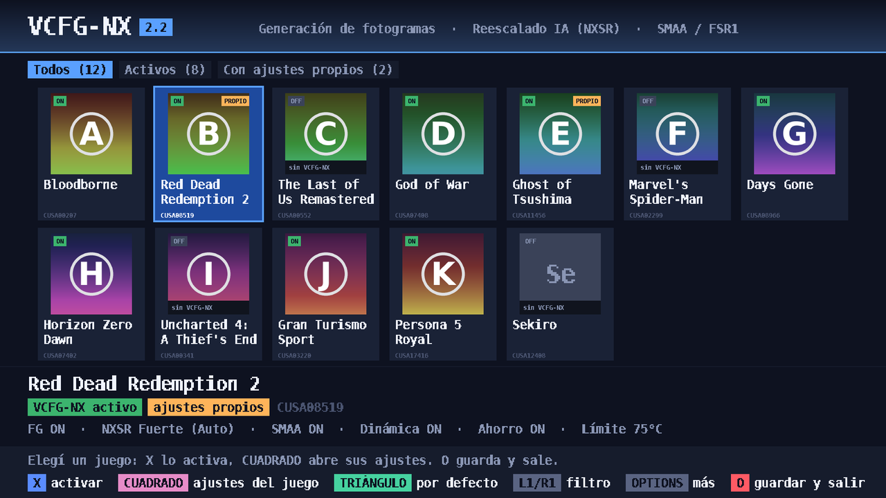
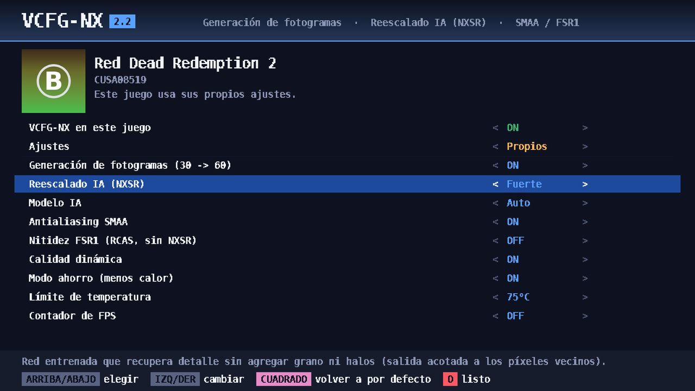

# VCFG-NX 2.2: frame generation + reescalado IA (NXSR) para PS4 (GoldHEN)

Rediseño del **VCFG v2.14** (generador de fotogramas en beta de la comunidad
de GoldHEN) que además incorpora un **modelo de reescalado/realce propio,
NXSR**, como alternativa a GNMScale pero sin el granulado que este agrega.
Todo con la interfaz de VCFG: app instaladora con lista de juegos y menú en
pantalla con **L3+R3**.

**Descarga:** [`dist/VCFG-NX_v2.20.pkg`](dist/VCFG-NX_v2.20.pkg) (fPKG, app) ·
[`dist/vcfg_nx.prx`](dist/vcfg_nx.prx) (plugin suelto) · [`dist/SHA256SUMS.txt`](dist/SHA256SUMS.txt)

| servicio | qué hace |
|---|---|
| **Generación de fotogramas** (NXFlow) | 30 → 60 fps: block-matching + red que corrige vectores y oclusiones. Sin cambios respecto de la 1.0 |
| **Reescalado IA (NXSR)** | red de 16 canales que reconstruye detalle (TAA borroso, render a menos resolución) y **nunca agrega grano ni halos**: su salida queda acotada al rango de los píxeles vecinos |
| SMAA 1x | antialiasing de bordes |
| FSR1 | EASU si el juego renderiza por debajo de la salida; RCAS como nitidez clásica (solo sin NXSR) |

> **Estado — leer antes de instalar.** Compila con el toolchain real
> (OpenOrbis + GoldHEN SDK), el PKG se genera y se verifica en PC, y toda la
> lógica del plugin se probó en un **simulador de consola** con detectores de
> errores de memoria. Pero **nada se ejecutó todavía en una PS4**: es una beta.
> Las protecciones de abajo existen para que, si algo falla, el juego siga
> como si el plugin no estuviera. Detalles en [`docs/resultados.md`](docs/resultados.md)
> y [`docs/DISENO_NX.md`](docs/DISENO_NX.md).

## NXSR frente a GNMScale

GNMScale ([análisis](docs/ANALISIS_GNMSCALE.md)) trae tres redes de 4 canales
que son filtros de nitidez aprendidos sin límite. Evaluadas sobre el mismo
conjunto (Urban100, BSD100, Set14 y Big Buck Bunny con degradaciones de
juego):

| método | PSNR | SSIM | PSNR en zonas planas (grano) | píxeles con halo |
|---|---|---|---|---|
| imagen sin procesar | 27.28 | 0.886 | 42.57 | 1.9 % |
| FSR1 RCAS | 26.79 | 0.868 | 35.59 | 18.2 % |
| GNMScale fidelity | 25.16 | 0.828 | 35.56 | 25.6 % |
| GNMScale sharp-fast | 24.92 | 0.829 | 35.71 | 26.2 % |
| GNMScale sharp | 25.11 | 0.825 | 35.52 | 26.5 % |
| **NXSR Rápido (VCFG-NX)** | **27.74** | **0.896** | **42.71** | **2.2 %** |
| **NXSR Calidad (VCFG-NX, PS4 Pro)** | **27.90** | **0.900** | **44.25** | **1.5 %** |

* GNMScale empeora la imagen: amplifica ruido en zonas planas (el granulado)
  y deja halos en uno de cada cuatro píxeles.
* NXSR mejora la imagen y mantiene zonas planas y bordes limpios. La mejora en
  PSNR es moderada: con ~1000 operaciones por píxel (lo que la GPU de la PS4
  puede pagar a 1080p junto con la generación de fotogramas) no se puede
  "inventar" mucho detalle; lo que gana es nitidez real sin artefactos.

## Novedades de la 2.2



* **App nueva**: cuadrícula con los juegos instalados y sus íconos, filtros
  (todos / activos / con ajustes propios) y un panel con lo que va a usar el
  juego elegido.
* **Ajustes por juego** desde la app: cada juego puede seguir los ajustes por
  defecto o tener los suyos (FG, NXSR, modelo, SMAA, RCAS, calidad dinámica,
  modo ahorro, límite de temperatura, contador de FPS). Es el mismo archivo
  que guarda el menú L3+R3 dentro del juego.
* **Menos memoria**: los buffers temporales del FG y del post-proceso
  comparten la misma región: 90 → 63 MiB a 1080p (−31 %), con salida idéntica
  byte a byte. Más juegos tienen memoria libre para activar los efectos.
* **La app no usa CPU en reposo**: solo redibuja cuando se toca un botón (antes
  redibujaba la pantalla entera 30 veces por segundo).
* Juegos en discos externos (`ext0`/`ext1`) sin repetir. Los modelos (NXFlow y
  NXSR) no cambiaron.



## Novedades de la 2.1

* **Dos modelos NXSR**: Rápido (16 canales, ~1 000 operaciones por píxel) y
  Calidad (24 canales y dos capas, ~3 300), que en "Auto" se usa solo si el
  juego corre en modo PS4 Pro. Calidad además limpia ruido en zonas planas y
  deja menos halos que la imagen original.
* **Calidad dinámica**: si la GPU no da abasto baja un escalón (Calidad →
  Rápido → sin SMAA → sin NXSR → sin FG) en vez de apagarse, y vuelve a subir
  sola cuando hay margen.
* **Protección térmica**: lee la temperatura cada 2 s; sobre 80 °C baja la
  calidad, sobre 86 °C pausa los efectos hasta que enfríe. **Modo ahorro**:
  modelo Rápido, sin SMAA y límite de 75 °C.
* **Más estable**: si el juego vuelve a registrar sus buffers (al volver del
  reposo, por ejemplo) se adapta en lugar de apagarse.
* **Más eficiente**: NXSR lee cada píxel una vez en vez de tres; el modelo
  Rápido se reentrenó con el doble de datos y una pérdida que reduce el
  parpadeo en movimiento (−14 %).

## Protecciones (para que no se cierre el juego ni pase nada a la consola)

* **Nada al arrancar**: el plugin no reserva memoria ni toca la GPU hasta que
  el juego lleva ~20 s mostrando imagen (`warmup_flips`).
* **Memoria**: solo reserva si al juego le quedan libres al menos `reserve_mb`
  (192 MiB) más lo necesario; si no, los efectos quedan apagados y reintenta
  más tarde. El menú necesita solo 32 MiB.
* **Anti-cierre**: si un juego se cierra con los efectos activos, la próxima
  vez arranca en **modo seguro** (efectos apagados, se avisa por notificación).
  Tras ~1 minuto estable, la sesión se marca como buena.
* **GPU**: si nuestro trabajo no termina a tiempo, ese fotograma sale intacto;
  si pasa 30 veces seguidas, el plugin se desactiva solo para esa sesión.
* **Cualquier cosa rara** (HDR, otro tamaño de buffers, índice desconocido,
  proceso que no es un juego) → el fotograma del juego pasa sin tocar.
* El instalador hace copia de seguridad de `plugins.ini`, verifica cada
  escritura y restaura el sandbox de la app al salir. Nunca escribe fuera de
  `/data/GoldHEN` y `/data/vcfg_nx`.

## Compatibilidad

Funciona con cualquier juego (no hay lista fija): se elige en la app. Soporta
las tres formas en que los juegos de PS4 presentan la imagen
(`sceGnmSubmitAndFlipCommandBuffers`, la variante `ForWorkload` y
`sceVideoOutSubmitFlip` desde la CPU), salida SDR de 8 y 10 bits de 720p a 4K
(PS4 Pro), y juegos que renderizan por debajo de la salida (900p/720p → 1080p
con EASU). Si el juego ya va a más de `max_game_fps` (48), la generación se
apaga sola y solo queda la mejora de imagen. No se toca: salida HDR, apps que
no son juegos (`CUSA`/`PLAS`).

## Instalar y usar

1. Requiere **GoldHEN** con soporte de plugins.
2. Instalar `VCFG-NX_v2.20.pkg` y abrir **VCFG-NX**.
3. En la cuadrícula: **X** activa o desactiva VCFG-NX en el juego,
   **CUADRADO** abre los ajustes de ese juego, **TRIÁNGULO** los ajustes por
   defecto, **L1/R1** cambia el filtro, **OPTIONS** abre el menú (activar o
   desactivar todos, quitar ajustes propios, desinstalar, salir sin guardar) y
   **CÍRCULO** guarda y sale.
   En los ajustes de un juego, cambiar cualquier valor lo pasa a "ajustes
   propios"; **CUADRADO** lo devuelve a los ajustes por defecto.
4. En el juego: mantener **L3+R3** 1,5 s abre el menú (el juego no recibe los
   botones mientras está abierto). Ahí se cambia cada efecto en vivo, se ve el
   contador de FPS, el modo **Comparar** (mitad izquierda original) y
   **Guardar** deja los ajustes para ese juego.

Configuración (`/data/vcfg_nx/config.ini`, o `/data/vcfg_nx/<TITLE_ID>.ini` por juego):

```ini
framegen = 1        ; 30 -> 60
sr = 2              ; NXSR: 0 off, 1 suave, 2 normal, 3 fuerte
sr_model = 0        ; 0 auto (Calidad en PS4 Pro), 1 rapido, 2 calidad
dynamic = 1         ; calidad dinamica
eco = 0             ; modo ahorro (menos calor)
temp_limit = 80     ; grados C; 0 = sin control termico
aa = 1              ; SMAA 1x
rcas = 0            ; nitidez FSR1 cuando NXSR esta apagado: 0..3
fps_counter = 0
compare = 0         ; mitad izquierda sin procesar
max_game_fps = 48   ; por encima, FG se apaga solo
menu_hold_ms = 1500 ; L3+R3 mantenido -> menu
warmup_flips = 600  ; fotogramas antes de reservar nada
reserve_mb = 192    ; memoria que siempre se le deja libre al juego
```

## Contenido

```
dist/                          PKG, plugin .prx y sumas SHA256
docs/ANALISIS_VCFG_v2.14.md    qué hay dentro del VCFG original
docs/ANALISIS_GNMSCALE.md      qué hay dentro de GNMScale y por qué agrega grano
docs/DISENO_NX.md              arquitectura, estados, protecciones, ABI de los shaders
docs/resultados.md             métricas y verificación
model/                         NXFlow (frame generation): datos, red, entrenamiento, export
sr/                            NXSR: datos, red, entrenamiento, evaluación (con GNMScale), export
upscale/                       referencias FSR1 y SMAA
shaders/                       kernels de GPU (.cl) -> ISA GCN gfx701
plugin/source/                 plugin: motor (nx_engine), tubería GPU, menú en pantalla, hooks
plugin/test/                   host_test, emulador del DCB, simulador de consola con ASan
installer/                     app (cuadrícula de juegos, ajustes por juego), edición segura de plugins.ini, PKG
installer/test/                test_core, test_app (la app entera con mando guionado) y capturas de pantalla
weights/                       pesos entrenados (nxflow.pkl, nxsr.pkl, nxsr_hq.pkl)
```

## Compilar y probar

```sh
pip install "jax[cpu]" optax pillow pyelftools pyyaml
shaders/build_gcn.sh                                   # .cl -> ISA gfx701 -> plugin/include/nx_shaders.h
make -C plugin/test all
plugin/test/host_test                                  # ABI de kernargs + PM4 de cada caso
plugin/test/console_sim                                # 18 escenarios: memoria, cierres, GPU, calor, menú
python3 plugin/test/test_gpu_path.py video.mp4 weights/nxflow.pkl
python3 plugin/test/test_smaa_path.py
python3 plugin/test/test_sr_path.py                    # NXSR: DCB emulado vs modelo
make -C installer/test                                 # app: archivos, interfaz de punta a punta
make -C installer OO_PS4_TOOLCHAIN=... GOLDHEN_SDK=... [SSL11_DIR=carpeta con libssl.so.1.1]
```

Reentrenar NXSR (con capturas del juego mejora más):

```sh
python3 sr/data_sr.py --images carpeta/ --videos captura.mp4 --out train_sr.npz
python3 sr/train_sr.py --data train_sr.npz --val val_sr.npz --C 16 --body 1 --margin 0 --lr 8e-3 --batch 32 --steps 12000 --out weights/nxsr.pkl
python3 sr/eval_sr.py --data val_sr.npz --nxsr weights/nxsr.pkl --gnmscale carpeta_models_gnmscale/
python3 sr/export_sr.py weights/nxsr.pkl plugin/include/nxsr_weights.h && shaders/build_gcn.sh
```

## ¿Y DLSS (HelixSR)?

No se puede usar en PS4: es una DLL de Windows/Direct3D 12, necesita vectores
de movimiento que los juegos de PS4 no exponen, apunta a GPUs RDNA, su licencia
prohíbe modificarla y los pesos de NVIDIA no se pueden redistribuir. Por eso
se agregó SMAA 1x (1.0) y ahora NXSR, entrenado desde cero.

## Créditos y licencias

* VCFG y GNMScale: autores de la comunidad GoldHEN. Este repo no incluye sus
  binarios ni sus pesos; solo el análisis.
* SMAA: Jimenez et al., MIT (`third_party/smaa/LICENSE.txt`). FSR1: AMD, MIT.
* Fuente del menú: DejaVu Sans Mono (licencia libre de Bitstream Vera/DejaVu).
* stb_image (Sean Barrett): dominio público / MIT, para los íconos de la app.
* Formato PKG/PFS: LibOrbisPkg (maxton). Toolchain: OpenOrbis y GoldHEN Plugins SDK.
* Datos: Big Buck Bunny (© Blender Foundation, CC-BY 3.0), Urban100, BSD100,
  Set14, Sun-Hays80, clips de muestra de scikit-video/OpenCV y escenas
  sintéticas propias.
