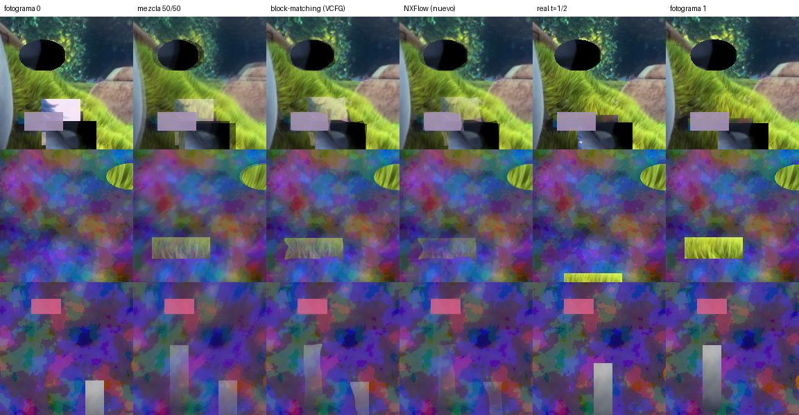

# Resultados

Todo medido en PC (CPU). Ningún número de esta página viene de una consola.

## 1. Generación de fotogramas

Se predice el fotograma `t = ½` a partir de `t = 0` y `t = 1`, y se compara con
el real. "block-matching (tipo VCFG)" es `model/baseline_bm.py`, que reimplementa
la parte central del original (pirámide + búsqueda por bloques + mediana + warp).

| conjunto | método | PSNR (dB) | SSIM |
|---|---|---|---|
| video (recortes 192 px, Big Buck Bunny, fotogramas no vistos) | repetir fotograma | 33.45 | 0.9543 |
| | mezcla 50/50 | 36.61 | 0.9653 |
| | block-matching (tipo VCFG) | 37.95 | 0.9754 |
| | **NXFlow híbrido (nuevo)** | **37.95** | **0.9759** |
| sintético tipo juego (HUD, oclusiones, giros de cámara) | repetir fotograma | 19.34 | 0.6044 |
| | mezcla 50/50 | 21.76 | 0.6463 |
| | block-matching (tipo VCFG) | 24.44 | 0.7906 |
| | **NXFlow híbrido (nuevo)** | **24.60** | **0.7960** |
| video completo 1280x720 | repetir fotograma | 34.45 | 0.9824 |
| | mezcla 50/50 | 34.51 | 0.9846 |
| | block-matching (tipo VCFG) | 37.03 | 0.9890 |
| | **NXFlow híbrido (nuevo)** | **37.07** | **0.9893** |

### Lectura honesta

* El enfoque de VCFG ya es bueno: +1,3 a +2,7 dB sobre la mezcla simple.
* El modelo nuevo **mejora poco** sobre él: +0,16 dB y +0,005 SSIM en el
  sintético, y prácticamente empate en video. Nunca rinde peor (por diseño
  arranca siendo el block-matching).
* Un análisis oráculo (elegir en cada píxel el mejor de los dos warps
  mirando el fotograma real) indica que hay ~+2 dB disponibles solo en manejo
  de oclusiones. La red, entrenada ~20 000 pasos en CPU con ~5 400 tripletes,
  captura una fracción mínima: la máscara aprendida casi no se aparta de 0,5.
* Experimentos que no mejoraron: red pura sin block-matching (se quedó al
  nivel de la mezcla 50/50), nivel extra a 1/4 sin supervisión (igual), peso
  de supervisión de máscara 15x mayor (−0,1 dB en video).

Para llegar a esos +2 dB hace falta más entrenamiento del que se puede hacer
en CPU: más datos (Vimeo-90k, y sobre todo **capturas del juego objetivo**) y
entrenar en GPU. Toda la tubería (datos → entrenamiento → export → shaders →
plugin) ya está lista para reentrenar sin tocar el código de la consola,
siempre que la arquitectura se mantenga.

## 2. Escalado (FSR1)

Big Buck Bunny 1280x720, reducido a 960x540 y vuelto a escalar:

| método | PSNR (dB) |
|---|---|
| bilineal | 39.42 |
| bicúbico | 41.48 |
| Lanczos | 41.77 |
| EASU (FSR1) | 40.58 |
| EASU + RCAS | 36.74 |

Como se esperaba, FSR1 no gana en PSNR: EASU está pensado para bordes nítidos
sin *ringing* y RCAS agrega nitidez percibida, que el PSNR penaliza. Frente al
escalador bilineal de VideoOut (lo que usa la consola cuando un juego entrega
900p/720p) EASU sí es mejor (+1,2 dB). La ventaja real de esta etapa es
perceptual y conviene juzgarla mirando (`pipeline/run.py --compare`).

## 3. Antialiasing (SMAA 1x)

Escena de prueba con bordes duros (`upscale/aa_testscene.py`, 256x160):
rectángulos rotados y círculos. Referencia: la misma escena con
supersampling 8x8 (64 muestras por píxel).

| método | PSNR vs SSAA 8x8 |
|---|---|
| sin AA (1 muestra por píxel, como un juego sin AA) | 31.74 dB |
| RCAS (la nitidez de FSR1) | 30.47 dB |
| **SMAA 1x** | **38.37 dB** |

SMAA recupera la mayor parte de la diferencia con el supersampling; RCAS la
empeora porque realza el escalonado. En juegos que ya traen su propio AA
(FXAA/TAA) el beneficio será menor: se puede apagar por juego con `aa = 0`.

## 4. Verificación del camino de GPU

| prueba | resultado |
|---|---|
| runtime NumPy vs JAX (mismos pesos) | dif. máx. ~2e-6 |
| `host_test`: offsets de kernargs de los 26 kernels vs metadatos del compilador | todos coinciden |
| `host_test`: DCB 1080p / 900p→1080p / 720p→1080p | PM4 bien formado, 39-43 dispatches, 36-70 MiB |
| `gpu_emu` (DCB ejecutado con los kernels compilados para x86) vs runtime NumPy, 1280x720 | dif. máx. 1/255 (≈88 dB) |
| RCAS del camino GPU vs `upscale/fsr1.py` | ≈59 dB |
| SMAA del camino GPU (3 kernels) vs `upscale/smaa.py` | idéntico (0/255) |
| `host_test` con SMAA | 45-49 dispatches, 45-90 MiB de memoria de trabajo |
| plugin compilado con OpenOrbis + GoldHEN SDK | `vcfg_nx.prx`, exporta `plugin_load`/`plugin_unload` |
| PKG (`PkgTool.Core`) descifrado con `tools/pkg/pfs_extract.py` | eboot y prx idénticos a los compilados |
| edición de `plugins.ini` del instalador (test en PC) | respeta lo existente, idempotente |

| NXSR del camino GPU (`wg_nxsr`, un pase con LDS) vs modelo JAX | dif. máx. 1/255 |
| FG + NXSR (mejora primero, FG interpola los reales ya mejorados) en el emulador | correcto |
| menú en pantalla (`osd_draw`) renderizado en el emulador | legible, fila seleccionada resaltada |
| `console_sim`: 11 escenarios con ASan + UBSan (ver abajo) | todos pasan, sin errores de memoria |
| test del instalador (`installer/test/test_core.c`, ASan) | lista de juegos, `plugins.ini` idempotente, desinstalar |

Lo que **no** está verificado: ejecución en la GPU real de la PS4 (tiling de
los backbuffers, coherencia de caches, orden de los flips, rendimiento).

## 5. Ejemplo visual

Los tres recortes sintéticos donde NXFlow más mejora al block-matching
(+1,0 a +1,7 dB). Se ve que corrige los bordes en bloque y parte del
"fantasma" en oclusiones, pero los objetos muy rápidos siguen saliendo mal en
ambos métodos: ahí está el margen que queda por ganar con más entrenamiento.

## 5b. Reescalado IA: NXSR frente a GNMScale

Validación: 800 recortes de 192 px de Urban100, BSD100, Set14 y Big Buck
Bunny (no vistos en el entrenamiento), con degradaciones de juego: render a
menor resolución (1x a 2x) reescalado, desenfoque tipo TAA, ruido y
cuantización a 8 bits. "Zonas planas" mide el PSNR solo donde el original es
liso (desvío local < 2/255: ahí todo cambio es grano); "halo" cuenta píxeles
que se salen más de 4/255 del rango 3x3 del original limpio.

| método | PSNR | SSIM | PSNR en zonas planas (grano) | píxeles con halo |
|---|---|---|---|---|
| imagen sin procesar | 27.28 | 0.886 | 42.57 | 1.9 % |
| FSR1 RCAS | 26.79 | 0.868 | 35.59 | 18.2 % |
| GNMScale fidelity | 25.16 | 0.828 | 35.56 | 25.6 % |
| GNMScale sharp-fast | 24.92 | 0.829 | 35.71 | 26.2 % |
| GNMScale sharp | 25.11 | 0.825 | 35.52 | 26.5 % |
| NXSR 2.0 | 27.68 | 0.895 | 42.73 | 2.2 % |
| **NXSR 2.1 Rápido** | **27.74** | **0.896** | **42.71** | **2.2 %** |
| **NXSR 2.1 Calidad** | **27.90** | **0.900** | **44.25** | **1.5 %** |

* NXSR: +0,40 dB y +0,009 SSIM sobre no hacer nada, sin grano (zonas planas
  incluso un poco mejor, porque limpia ruido) y con halos al nivel del
  original. 16 canales, 4 268 pesos, 1 056 MAC/píxel; entrenado 12 000 pasos
  en CPU (lote 32, Charbonnier + gradiente).
* La mejora es modesta: es una red chica para que quepa en la GPU de PS4 junto
  con la generación de fotogramas. Más datos (capturas del juego) y
  entrenamiento en GPU deberían subirla sin cambiar el plugin.
* Experimentos: margen del limitador 0 (27,55) vs 0,25 (27,49) vs sin
  limitador (27,47); C = 24 con 2 capas igualó a C = 16 con 1 al doble de
  coste, por eso quedó C = 16.

### 2.1: modelos nuevos

Parpadeo = cambio medio de la salida (en /255) cuando la imagen se mueve un
píxel en diagonal; los filtros sin reescalado interno (RCAS, GNMScale) dan 0
por construcción.

| modelo | operaciones/píxel | PSNR | parpadeo |
|---|---|---|---|
| NXSR 2.0 | 1 056 | 27.68 | 0.61 |
| NXSR 2.1 Rápido | 1 056 | 27.74 | 0.52 |
| NXSR 2.1 Calidad | 3 312 | 27.90 | 0.70 |

* Datos: 32 000 recortes (antes 16 000). Entrenamiento: 20 000 pasos, ramas
  1x1/identidad plegables (re-parametrización: +0,01 dB, mismo coste) y
  pérdida de consistencia ante desplazamientos con peso 0,15 (con peso 1 el
  parpadeo baja a 0,06 pero se pierden 0,27 dB).
* Calidad con lr 8e-3 divergió; con 3e-3 entrenó estable. El entrenador ahora
  vuelve al mejor punto y reduce el paso si la validación cae más de 1 dB
  (actuó una vez en el Rápido).
* La mejora sigue siendo moderada: son redes chicas para que quepan en la
  GPU de la PS4. Calidad cuesta ~3 veces más que Rápido; la PS4 Pro tiene
  ~2,3 veces la GPU de la normal.

## 6. Simulador de consola (evaluación segura)

`plugin/test/console_sim.c` compila el **mismo motor** del plugin
(`nx_engine.c`, `nx_pipeline.c`, menú) contra una consola simulada: memoria
directa limitada, GPU que puede atrasarse, archivos en `/data`, mando y flips.
Así se prueban en el PC, con AddressSanitizer y UndefinedBehaviorSanitizer,
los casos que en una PS4 terminarían en un juego cerrado.

| escenario | qué se comprueba | resultado |
|---|---|---|
| 1. 30 fps, memoria de sobra | no reserva nada en el arranque (600 flips); después FG activo | activo |
| 2. memoria insuficiente | nunca baja de la reserva del juego; efectos apagados, menú vivo | efectos apagados, 0 trabajos propios |
| 3. GPU trabada | cada flip atrasado pasa intacto; a los 30 seguidos se desactiva | degradado, juego sigue |
| 4. sesión tras un cierre | arranca en modo seguro; se puede reactivar desde el menú | modo seguro → activo |
| 5. menú y guardado | L3+R3, navegación, el juego no recibe botones, `.ini` por juego | correcto |
| 6. juego HDR | no se toca nada | inactivo, todo pasa |
| 7. juego a 60 fps | FG apagado solo, mejora de imagen sigue | activo |
| 8. re-registro de buffers | el plugin se aparta | degradado, juego sigue |
| 9. ForWorkload + 2000 llamadas aleatorias | índices/handles inválidos, argumentos basura | sin fallos de memoria |
| 10. proceso que no es un juego | ni hooks | inactivo |
| 11. juego con flips de CPU | `sceVideoOutSubmitFlip` | activo |
| 3b. GPU trabada con trabajo propio | pausa y reintento a los ~3 min | vuelve a calidad completa |
| 12. GPU justa (modelo de tiempos: juego 24 ms + efectos ~12 ms) | calidad dinámica | baja 1 escalón sin atrasos; con escena liviana vuelve a 0 |
| 13. re-registro con la misma geometría | adopta los buffers nuevos | sigue activo |
| 14. re-registro antes de activar efectos | empieza de nuevo | activo con la nueva resolución |
| 15. modelo Auto en PS4 Pro / normal / `sr_model = 2` | elección del modelo | correcto |
| 16. temperatura 65 → 82 → 90 → 77 → 68 °C | baja, pausa, no sube sin margen, recupera | correcto; lectura imposible ignorada |
| 17. modo ahorro en Pro | sin Calidad ni SMAA | −48 % de grupos de GPU por fotograma |
